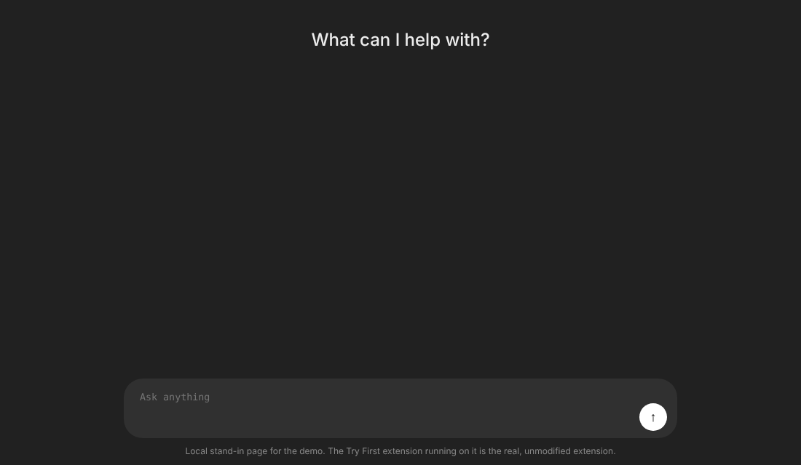
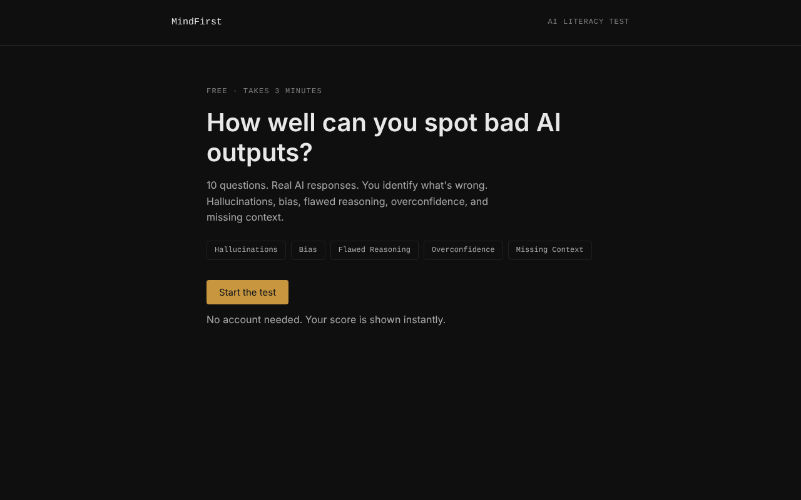
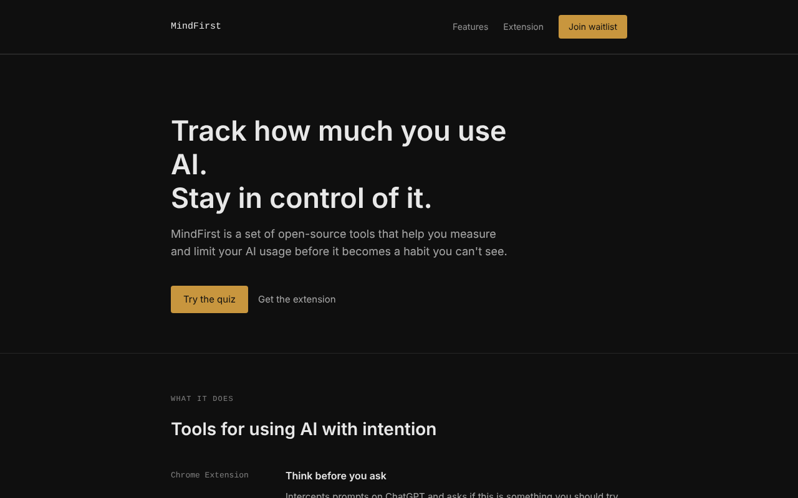
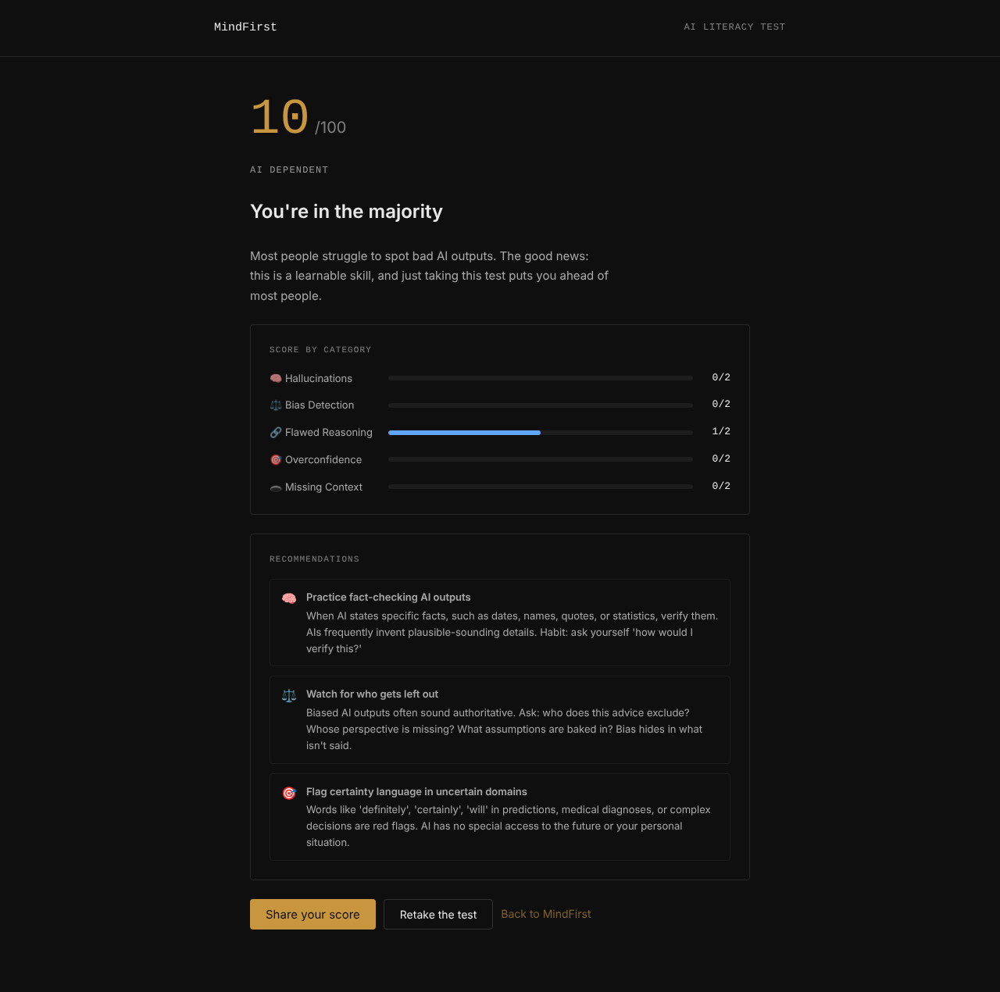
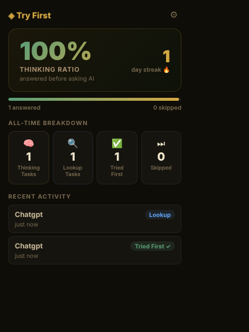

# MindFirst

MindFirst is a suite of tools for people who want to use AI without becoming dependent on it. It tracks how much time you spend in AI apps, nudges you to think before you ask, and helps you measure whether your own reasoning skills are improving or atrophying.

This repository contains three components that work independently.

<p align="center">
  
</p>

*The Chrome extension in action: a reasoning prompt gets stopped and you are asked for your own answer first, while a plain factual question goes straight through. Recorded with the real, unmodified extension on a local stand-in for ChatGPT's page, with the classifier's reply stubbed, since the real site needs a login.*

---

## What's in this repo

| Component | Folder | Description |
|-----------|--------|-------------|
| Website | `website/` | Static landing page with an AI literacy quiz, an AI usage logger, and a roast feature |
| Chrome Extension | `extension/` | Intercepts prompts on AI chat sites, classifies them as thinking vs lookup tasks, and asks you to attempt an answer first |
| Desktop App | `desktop-app/` | macOS menu bar app that tracks time spent in AI applications and sends daily usage notifications |

The extension's hosted classifier is a small Cloudflare Worker, kept in a separate project (`mindfirst-classify-api`).

---

## Website

<p align="center">
  
</p>

| Landing page | Score breakdown from the quiz |
|---|---|
|  |  |

The quiz draws 10 questions at random from a pool of 30, two from each of five categories (hallucinations, bias detection, flawed reasoning, overconfidence, missing context), with the answer order shuffled every time. Each question shows an AI answer and asks you what is wrong with it, then explains why. Your results show a score per category plus tailored recommendations. The log page tracks AI sessions you enter by hand, and the roast page takes a ChatGPT, Claude, or Gemini conversation you paste in and gives you an honest read on how dependent you sound. The analysis runs entirely in your browser.

It is a plain static site with no build step.

```bash
cd website
# Open index.html in your browser, or serve it:
npx serve .
```

---

## Chrome Extension

The extension activates on ChatGPT, Claude, Gemini, Copilot, Perplexity, Poe, and Character.AI. When you press send, it classifies the prompt as a thinking task (writing, problem solving, analysis, anything with multiple steps) or a lookup task (a single factual question). Lookups go through untouched. Thinking tasks show a small popup asking you to attempt the answer yourself first, and your answered/skipped streak is tracked in the extension popup.

<p align="center">
  
</p>

### Install

1. Open Chrome and go to `chrome://extensions`
2. Enable **Developer mode** (top right toggle)
3. Click **Load unpacked** and select the `extension/` folder

### How classification works

- By default the extension sends the first 600 characters of your prompt to the hosted classifier Worker, which asks `claude-haiku-4-5` for a one-word verdict. Each install gets an anonymous random UUID, and the Worker allows 5 free classifications per day per install.
- After the free limit, the extension falls back to your own Anthropic API key if you saved one (extension popup, settings icon). Get one at [console.anthropic.com](https://console.anthropic.com). The key is stored in `chrome.storage.local` on your device only.
- If the Worker is unreachable, the limit is hit with no key saved, or classification takes longer than 6 seconds, the extension lets your prompt through. It never blocks you on its own failure.
- The activity log stores only the verdict, whether you answered, the site, and a timestamp. Prompt text is not stored.

---

## Desktop App (macOS)

```bash
cd desktop-app
npm install
npm start          # run in development
npm run build      # build a .dmg installer
```

On first launch, macOS will ask for **Automation permission** so the app can detect which app is in the foreground. Grant it.

The app tracks time in: ChatGPT, Claude, Copilot, Notion, Perplexity, and any app whose name contains "AI". Data is stored locally at `~/Library/Application Support/MindFirst/mindfirst-data.json`.

---

## Prerequisites

- Node.js 18+ and npm (for the desktop app)
- A Chromium-based browser (Chrome, Brave, Arc) for the extension

---

## License

MIT
